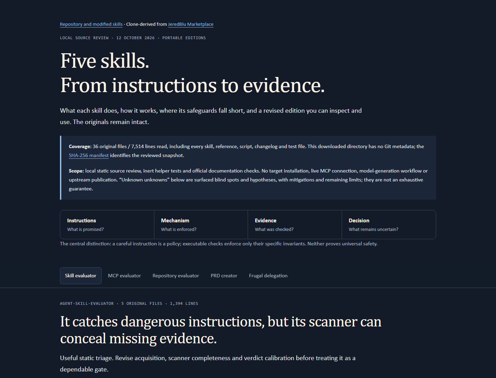

# Evaluator Skills

This is a **clone-derived, independently analyzed and modified edition of [JeredBlu’s original jeredblu-marketplace repository](https://github.com/JeredBlu/jeredblu-marketplace)**, created by Jered Blumenfeld. The starting point was a downloaded snapshot, not a Git checkout with verified ancestry. This repository has its own history and is not an official upstream release or endorsement.

## Live HTML report

**[Open the interactive GitHub Pages report](https://az9713.github.io/evaluator-skills/)** — five horizontal tabs, one per skill: purpose, mechanism, source-backed gaps, complete revised instructions, and blind spots with mitigations.

The image is a rendered preview; click it for the live interactive page. GitHub README rendering does not execute this page’s JavaScript or host it as a live iframe.

| Skill | Live analysis | Revised source | Download |
|---|---|---|---|
| Agent Skill Evaluator | [Report tab](https://az9713.github.io/evaluator-skills/#agent-skill-evaluator) | [SKILL.md](jeredblu-tools/skills/agent-skill-evaluator/SKILL.md) | [ZIP](https://az9713.github.io/evaluator-skills/packages/agent-skill-evaluator.zip) |
| MCP Evaluator | [Report tab](https://az9713.github.io/evaluator-skills/#mcp-evaluator) | [SKILL.md](jeredblu-tools/skills/mcp-evaluator/SKILL.md) | [ZIP](https://az9713.github.io/evaluator-skills/packages/mcp-evaluator.zip) |
| Repository Evaluator | [Report tab](https://az9713.github.io/evaluator-skills/#repo-evaluator) | [SKILL.md](jeredblu-tools/skills/repo-evaluator/SKILL.md) | [ZIP](https://az9713.github.io/evaluator-skills/packages/repo-evaluator.zip) |
| PRD Creator | [Report tab](https://az9713.github.io/evaluator-skills/#prd-creator) | [SKILL.md](jeredblu-tools/skills/prd-creator/SKILL.md) | [ZIP](https://az9713.github.io/evaluator-skills/packages/prd-creator.zip) |
| Frugal Delegation | [Report tab](https://az9713.github.io/evaluator-skills/#frugal-fable) | [SKILL.md](jeredblu-tools/skills/frugal-fable/SKILL.md) | [ZIP](https://az9713.github.io/evaluator-skills/packages/frugal-fable.zip) |

[Download all five revised skills](https://az9713.github.io/evaluator-skills/packages/revised-skills.zip).

## How the skills were analyzed

The review read **all 36 files / 7,514 lines** in the supplied skill directories: every entrypoint, reference, script, changelog and regression-test file. [The SHA-256 manifest](analysis/evidence/source-manifest.json) identifies the exact snapshot, preserved in [analysis/original-snapshot](analysis/original-snapshot). [UPSTREAM-README.md](UPSTREAM-README.md) preserves the original introduction.

For each skill, the analysis compared the instructions’ promises with the actual helper mechanisms. Findings cite source files/lines and distinguish implementation defects from broader limitations. Technical claims were checked against primary sources: [Node vm](https://nodejs.org/api/vm.html), the named [MCP security baseline](https://modelcontextprotocol.io/specification/2025-11-25/basic/security_best_practices) and [transports](https://modelcontextprotocol.io/specification/2025-11-25/basic/transports), [Python ZIP handling](https://docs.python.org/3/library/zipfile.html), and [Amazon SES](https://aws.amazon.com/ses/).

Revised copies were tested with inert fixtures and independently forward-reviewed against realistic scenarios. That pass uncovered additional Windows junction, credential-output and accounting problems; focused fixes and independent rechecks followed. The [initial review](analysis/evidence/independent-review.md) and [recheck history](analysis/evidence/independent-recheck.md) retain the progression and closure evidence. Earlier findings describe earlier revisions.

No evaluated target was installed or launched. No live MCP, external model-generation workflow, cross-provider CLI delegation or billable provider adapter was used to validate the skills. Static/inert review does not certify safety or prove production model compliance.

## What changed and why

### Agent Skill Evaluator

- Replaced the Bash scanner’s truncated previews with a portable Python lead ledger. The original suppressed read errors and could hide files after its 60-file limit; the replacement retains all detected lead locations and exposes gaps/errors.
- Added validated ZIP/TAR extraction: temporary directories alone do not stop traversal. Member paths, links, special entries, collisions and count/size limits are checked before writes.
- Removed invented safety percentages and unqualified SAFE verdicts. Reachable impact, evidence and coverage determine the recommendation; unknowns stay visible.
- Rewrote misleading safe examples: cwd and timeout are not sandboxes. Added Markdown Unicode leads and stable Windows junction/reparse boundaries.
- Suppressed matching source content and skipped credential-bearing files to avoid printing embedded secrets.

[Exact diff](analysis/diffs/agent-skill-evaluator.diff).

### MCP Evaluator

- Added static-only acquisition, exact-source/deployment separation and portable scanning/extraction.
- Added transport-aware checks: stdio OS authority differs from HTTP authentication/authorization. Examine token audience/scopes, passthrough, OAuth consent/state, Origin/local binding, session separation and metadata SSRF.
- Removed unsafe safe-example claims: string-prefix containment accepts sibling paths, and Node vm is not a security sandbox. Supplied tested component-containment and strict integer helpers, with their limits stated.
- Corrected claims about hashed usernames, shallow redaction, mutation retries, secret byte/string handling and numeric configuration validation.
- Added tool-description/result trust boundaries, cancellation/idempotency, resource/cost limits and re-review triggers.

[Exact diff](analysis/diffs/mcp-evaluator.diff).

### Repository Evaluator

- **Preserved the original 22-check rubric 1.1.0 and deterministic scoring policy.** Score, coverage, severity caps and unknowns remain distinct. A score is not a probability of safety.
- Fixed Windows evidence paths and UTF-8 reads. Added an isolated public-GitHub Python fetcher; direct Python commands avoid ambiguous Windows bash resolution.
- Removed the authentication hard stop for local/offline analysis. Missing provenance stays unknown; a directory without a verified commit receives an unscored assessment rather than a fabricated SHA.
- Fixed junction traversal and evidence disclosure. Raw scripts, dependency-source URLs and unresolved requirement values are omitted; credential-bearing Swift URL identities are not advisory candidates.
- Documented macOS artifact/provenance sampling limits. The legacy artifact helper was not comprehensively rewritten; source/binary equivalence remains separate.

[Exact diff](analysis/diffs/repo-evaluator.diff).

### PRD Creator

- Replaced interview quotas with material uncertainty: respect supplied context, settled choices and requests to draft immediately.
- Aligned the entrypoint and four references; removed code examples contradicting the no-code rule and an email service being compared with payment processors.
- Added stable requirement IDs, source/status, measurable acceptance and verification methods.
- Distinguished confirmed facts, proposals, assumptions and fictional examples; current costs need official sources, dates and workload assumptions.
- Added proportionate lifecycle/export/restore, operational and exit-cost considerations, plus AI evaluation when applicable. Writing a PRD does not authorize building, spending or publishing.

[Exact diff](analysis/diffs/prd-creator.diff).

### Frugal Delegation

- Replaced proprietary Workflow templates with a provider-neutral scheduler requiring an explicit adapter. Discover actual tools, model IDs and account constraints instead of assuming older mappings.
- Corrected the hard-budget claim: output usage multiplied by a fixed ratio cannot enforce total spend. Reserve inclusive upper bounds before concurrent dispatch; bound calls/concurrency and account synthesis.
- Separated measured usage, estimated reservation charges and conservative accounting, including per-task usage basis. True provider-level ceilings require an enforcing adapter.
- Reject missing/failed verification, stopped work, unsafe output paths and unknown tiers.
- Keep disputed/unknown research votes distinct from supported claims. Require unique run IDs, disjoint ownership, appropriate reviewer capabilities and explicit context-sharing boundaries.

[Exact diff](analysis/diffs/frugal-fable.diff).

## Validation and remaining limits

The original repository suite ran 56 tests on the producing Windows/Python 3.13 host: **50 passed, 6 failed**. The revised suite ran 56: **53 passed, 3 POSIX fixtures skipped**. The portable suite passed **15**, and the mocked-adapter scheduler suite passed **10**: **78 passed / 3 explicit skips** overall. See [validation](analysis/evidence/validation.json) and [logs](analysis/evidence).

All five entrypoints passed frontmatter validation. Browser checks covered tabs, keyboard navigation, evidence expansion, calculator behavior and desktop/mobile geometry, with no overflow or console errors. [Prepublication evidence](analysis/evidence/browser-validation.json) is separate from [hosted verification](https://az9713.github.io/evaluator-skills/evidence/live-browser-validation.json).

Remaining limits: hostile filesystem races, parser vulnerabilities, deployment configuration, source/binary equivalence, empirical scoring/detection calibration, actual model behavior and provider-level economic enforcement. Private package identities/metadata are not anonymized by hiding credential values. Clearer instructions do not implement an OS sandbox or a provider adapter.

## Use and reproduce

The canonical modified skills are under jeredblu-tools/skills/. Choose one edition per skill to avoid duplicate-name routing.

Claude Code marketplace:

    /plugin marketplace add az9713/evaluator-skills
    /plugin install jeredblu-tools@evaluator-skills

For Codex or another compatible harness, copy the complete selected skill folder into its skill location or use its import interface. Installation was not tested here; runtime capabilities and permissions still apply.

Offline checks from the repository root:

    python -B analysis/scripts/validate_package.py
    python -B scripts/build_site.py
    python -B scripts/check_public.py

Python 3.11+ and Node.js are recommended. The junction regression needs Windows/native PowerShell and is skipped elsewhere. Three inherited POSIX fixtures are skipped on Windows. These tests need no model API key.

docs/ is the Pages surface (main:/docs, with .nojekyll), containing the HTML, evidence, exact diffs, complete revised folders and matching ZIPs. analysis/ preserves the source snapshot, generation scripts and fixtures. Public evidence removes local user/filesystem identifiers.

## Attribution and edition status

Original design/source: **Jered Blumenfeld / [JeredBlu](https://github.com/JeredBlu/jeredblu-marketplace)**. Upstream files and history remain credited as upstream material; the analysis and modified editions are maintained here.

Four editions use 2.0.0-review.1; the repository evaluator uses 1.3.0-review.1 with rubric 1.1.0. These are local review identifiers, not upstream releases. No upstream license file was supplied in the snapshot, and GitHub reported no detected upstream license when checked. This repository does not assign a new license to upstream material.
